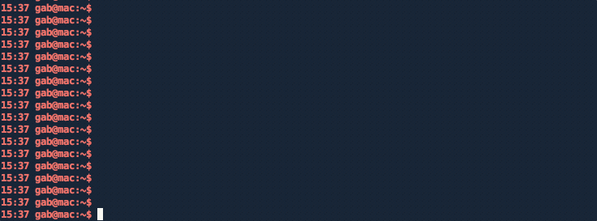

# Vault

[](https://pypi.org/project/pyvault)
[](https://github.com/gabfl/vault/actions)
[](https://codecov.io/gh/gabfl/vault)
[](https://raw.githubusercontent.com/gabfl/vault/main/LICENSE)

Vault is a simple Python password manager. It allows you to securely save secrets with a simple CLI interface.

## Features

 - Secrets are stored in an encrypted SQLite database with [SQLCipher](https://www.zetetic.net/sqlcipher/)
 - Within the database, each password and notes are encrypted with a unique salt using AES-256 encryption with [pycryptodome](http://legrandin.github.io/pycryptodome/)
 - Master key is hashed with a unique salt
 - Possibility to create an unlimited number of vaults
 - Clipboard cleared automatically
 - Automatic vault locking after inactivity
 - Password suggestions with [password-generator-py](https://github.com/gabfl/password-generator-py)
 - Import / Export in Json

## Basic usage



## Installation and setup

Vault is tested on Python 3.11 to 3.15. SQLCipher is bundled with the [sqlcipher3](https://pypi.org/project/sqlcipher3/) package on macOS, Linux and Windows, so you do not need to install it separately.

```bash
pip3 install pyvault

# Run setup
vault
```

On Linux, copying secrets to the clipboard requires `xclip` (or `xsel`):

```bash
sudo apt install -y xclip
```

### Upgrading from 2.4.5 or earlier

Earlier versions used the SQLCipher library installed on your system. Vault now uses the bundled SQLCipher 4, which opens any vault created with SQLCipher 4.x (the version shipped by Homebrew and by Ubuntu 20.04 and later). If your vault was created with SQLCipher 3.x, export it with your current version before upgrading and import it again afterwards (see [import](docs/import.md)):

```bash
vault --export vault_backup.json        # before upgrading
pip3 install -U pyvault
vault --import_items vault_backup.json  # after upgrading, then delete vault_backup.json
```

If no prebuilt package exists for your platform, pip builds `sqlcipher3` from source. You then need the SQLCipher headers (`brew install sqlcipher` on macOS, `sudo apt install -y gcc python3-dev libsqlcipher-dev` on Ubuntu/Debian).

### Using Docker

```bash
# Pull the image
docker pull gabfl/vault

# Create local directory
mkdir ~/.vault

# Launch image
docker run -v ~/.vault:/root/.vault -ti gabfl/vault
```

### Cloning the project

```bash
# Clone project
git clone https://github.com/gabfl/vault && cd vault

# Installation
pip3 install .

# Run setup
vault
```

## Advanced settings:

```
usage: vault [-h] [-t [CLIPBOARD_TTL]] [-p [HIDE_SECRET_TTL]]
             [-a [AUTO_LOCK_TTL]] [-v VAULT_LOCATION] [-c CONFIG_LOCATION]
             [-k] [-i IMPORT_ITEMS] [-x EXPORT] [-f [{json}]] [-e]

optional arguments:
  -h, --help            show this help message and exit
  -t [CLIPBOARD_TTL], --clipboard_TTL [CLIPBOARD_TTL]
                        Set clipboard TTL (in seconds, default: 15)
  -p [HIDE_SECRET_TTL], --hide_secret_TTL [HIDE_SECRET_TTL]
                        Set delay before hiding a printed password (in
                        seconds, default: 15)
  -a [AUTO_LOCK_TTL], --auto_lock_TTL [AUTO_LOCK_TTL]
                        Set auto lock TTL (in seconds, default: 900)
  -v VAULT_LOCATION, --vault_location VAULT_LOCATION
                        Set vault path
  -c CONFIG_LOCATION, --config_location CONFIG_LOCATION
                        Set config path
  -k, --change_key      Change master key
  -i IMPORT_ITEMS, --import_items IMPORT_ITEMS
                        File to import credentials from
  -x EXPORT, --export EXPORT
                        File to export credentials to
  -f [{json}], --file_format [{json}]
                        Import/export file format (default: 'json')
  -e, --erase_vault     Erase the vault and config file
```
